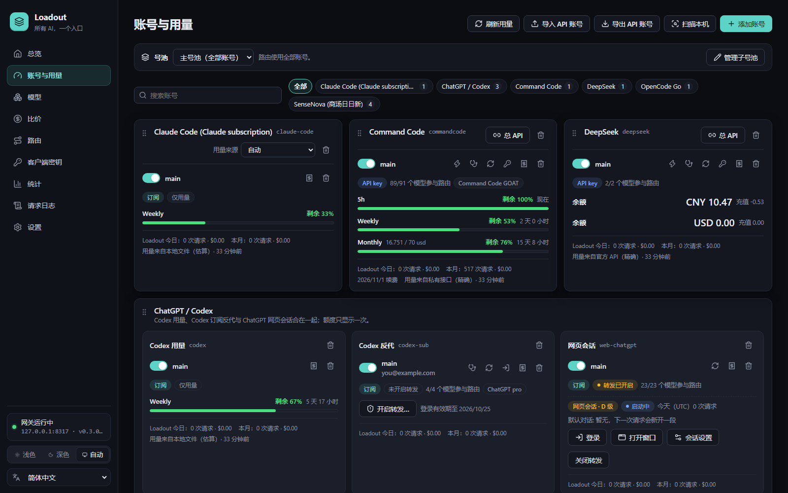
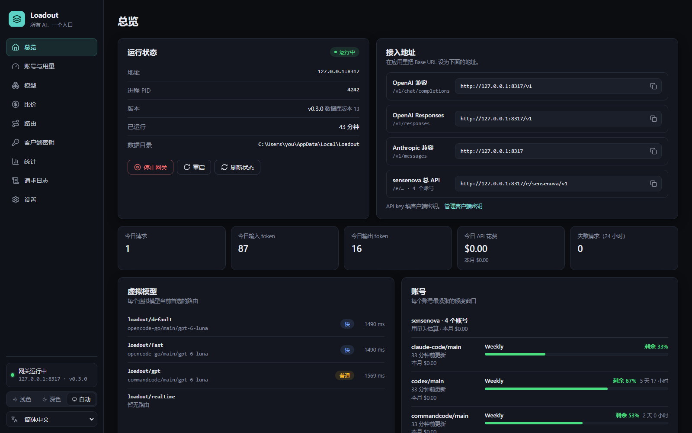
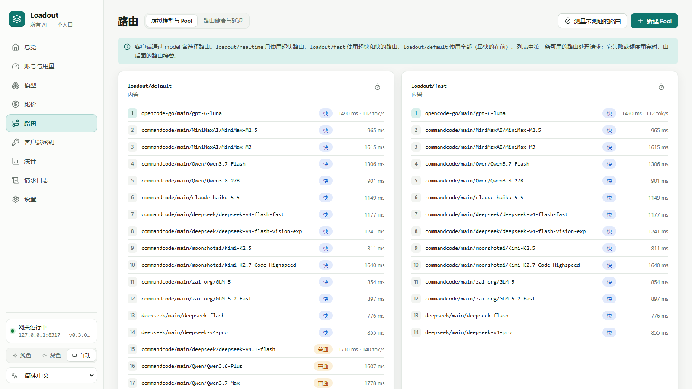
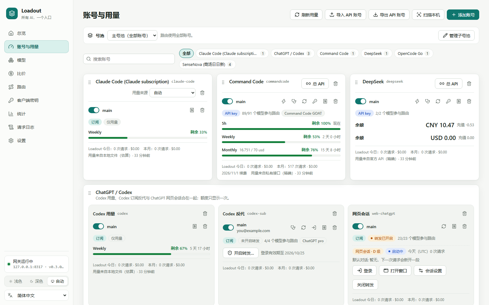
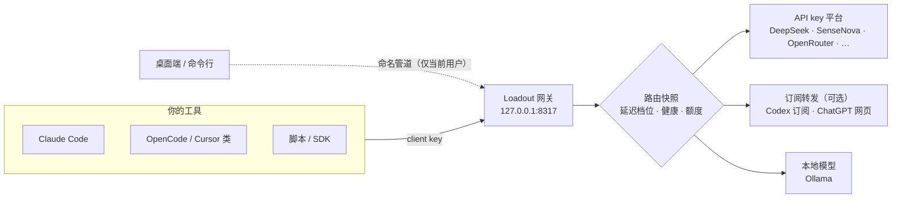

<div align="center">


# Loadout

**All your AI, one endpoint.**

你已有的 API key、订阅、余额和本地模型，汇成一个本地的 OpenAI / Anthropic 兼容接口。<br/>
自动选最快的路由，出错立刻换下一条，用量一目了然 —— 数据和密钥都只在你的电脑上。

[](https://github.com/SeaserL/Loadout/releases/latest)
[](#安装)
[](LICENSE)
[](#从源码构建)

[下载](https://github.com/SeaserL/Loadout/releases/latest) · [快速开始](#快速开始) · [提供方](#支持的提供方) · [文档](#文档)



</div>

> **English:** Loadout is a Windows desktop app and local gateway that pools your API keys, subscriptions and local models behind one OpenAI- / Anthropic-compatible endpoint on `127.0.0.1`. It routes by measured latency, fails over automatically, shows quotas and balances in one place, and keeps every key in Windows Credential Manager. The UI is available in Simplified Chinese and English.

---

## 为什么用 Loadout

v0.4 起，“设置 → 软件更新”每六小时检查本仓库的正式 Release，默认自动下载并校验 SHA-256。可手动安装，或显式开启自动安装与重启。只有 `%LOCALAPPDATA%\Programs\Loadout` 标准安装支持内置替换；开发目录只下载。安装前备份程序，失败恢复旧程序，数据库迁移的回退能力仍取决于版本兼容性。v0.3 用户需先用 v0.4 发布包升级一次。

私有仓库更新读取本机 Git Credential Manager 已有的 GitHub 登录，账号须有仓库读取权限；不交互登录、不另存凭据。安装失败会暂停自动安装，避免反复重启，需手动重试。

OpenCode 免费模型仍属实验性连接，存在官方原生调用也返回 403 的情况。v0.4 提供单并发、120 秒间隔、403 后 30 分钟冷却保护，无法保证避免上游限制。已有外部桥接还须应用同 Release 的 `opencode-bridge.zip` 脚本更新包，详见 [OpenCode 限制与安装说明](docs/providers/opencode-free.md)。

| | |
|---|---|
| 🔌 **一个地址接入所有工具** | Claude Code、OpenCode、Cursor 类工具、你自己的脚本，只要支持 OpenAI 或 Anthropic API，填一个 Base URL 和一把 client key 就能用。三种协议（Chat / Responses / Messages）自动互转，流式同样支持。 |
| ⚡ **按延迟自动选路** | 实测首 token 时间，把路由分成 超快 / 快 / 普通 三档。`loadout/realtime`、`loadout/fast`、`loadout/default` 永远先用最快的那条，平时粘在同一条上，保护上游的 prompt cache。 |
| 🔁 **出错立刻换下一条** | 限流、额度用完、凭证失效、超时……自动切到下一条路由，冷却到期后再回来（专用端点里的账号由后台探测确认恢复）。卡片上实时显示"限流中 · 18 秒后恢复"。 |
| 📊 **用量、余额、订阅一屏看完** | Codex、Claude Code、Gemini CLI、Kimi Code 的额度窗口，DeepSeek / Moonshot / OpenRouter 的余额，以及 Loadout 自己统计的请求数、token 和花费。 |
| 🧩 **专用端点（总 API）** | 给某个平台单独一个地址，例如 `http://127.0.0.1:8317/e/sensenova/v1`：客户端用裸模型名，请求在该平台的所有账号间自动 failover，全部限流时还会等第一个恢复的账号接手。 |
| 🗂️ **子号池** | 把一部分账号存成"子号池"，一键切换后路由只用这些账号；随时切回主号池。 |
| 🔐 **密钥只在本机** | API key 存在 Windows 凭据管理器，从不写进数据库或日志；请求日志只记元数据，不存提示词和回复。想和朋友共享账号？可以一键导出**加密**文件（两步确认）。 |
| 🖐️ **顺手的桌面端** | 拖动卡片调整顺序（账号顺序就是 failover 顺序），宽屏自动多列，深色 / 浅色主题，托盘常驻，关窗不停网关。 |

## 截图

<table>
  <tr>
    <td width="50%"><br/><sub><b>总览</b>：运行状态、接入地址（含专用端点）、今日用量、虚拟模型当前首选路由</sub></td>
    <td width="50%"><br/><sub><b>路由</b>：每个虚拟模型的路由顺序、延迟档位与输出速度</sub></td>
  </tr>
  <tr>
    <td colspan="2"><br/><sub><b>账号与用量</b>（浅色主题）：ChatGPT / Codex 合并卡片 —— Codex 用量、Codex 反代、网页会话放在一起，额度只显示一次</sub></td>
  </tr>
</table>

## 工作原理



- 网关是独立的后台进程（`loadoutd`），桌面端和命令行只是通过命名管道控制它的客户端；关掉窗口网关照常工作。
- 选路只读内存中的路由快照，请求路径上没有数据库查询和额外网络请求。
- 用量、余额、延迟测量都在后台定时刷新。

---

## 安装

### 从发布包安装（推荐）

1. 从 [Releases](https://github.com/SeaserL/Loadout/releases/latest) 下载 `Loadout-<版本>-windows-x64.zip` 并解压。
2. 双击 `install.cmd`（或 `powershell -ExecutionPolicy Bypass -File install.ps1`）。可选参数：
   - `-AddToPath`：在新终端里可以直接使用 `loadout` 命令
   - `-Autostart`：登录 Windows 时自动启动网关
   - `-NoStart`：安装后不立即启动
3. 从开始菜单打开 **Loadout**。

| 内容 | 位置 |
|---|---|
| 程序 | `%LOCALAPPDATA%\Programs\Loadout`（`loadout-app.exe` 桌面端、`loadoutd.exe` 网关、`loadout.exe` 命令行） |
| 数据 | `%LOCALAPPDATA%\Loadout`（数据库、日志、备份） |
| API key | Windows 凭据管理器（目标名以 `loadout:` 开头），**从不**写入数据库或日志 |

**升级**：解压新版本后再次运行 `install.cmd`（先优雅停止网关，替换程序后重新启动；数据库会自动迁移）。
**卸载**：`powershell -ExecutionPolicy Bypass -File "%LOCALAPPDATA%\Programs\Loadout\uninstall.ps1"`，加 `-RemoveData` 同时删除数据与已保存的 API key。

系统要求：Windows 10 / 11 x64，WebView2 Runtime（通常已预装）。

### 从源码构建

需要：Rust（版本由 `rust-toolchain.toml` 固定）、Visual Studio Build Tools（C++）、Node.js LTS、WebView2。

```text
npm install
npm run build                                     # 桌面端前端（必须先于 cargo 构建）
cargo build --release -p loadout -p loadout-desktop
powershell -ExecutionPolicy Bypass -File scripts\package.ps1   # 生成 dist\Loadout-<版本>-windows-x64.zip
```

开发规则见 [AGENTS.md](AGENTS.md)。

---

## 快速开始

### 桌面端

1. **账号与用量 → 添加账号**：选择提供方，填入 API key，模型列表会自动同步。
   **扫描本机** 可发现已登录的 Codex / Claude Code / Gemini CLI / Kimi Code，导入后显示其额度（Claude Code 也能从 Claude 桌面应用识别）。
2. **客户端密钥 → 新建**：为每个应用创建一把 client key（只显示一次）。
3. 在应用里设置 Base URL `http://127.0.0.1:8317/v1`，API key 填上面的 client key，模型名见[下文](#模型名)。
4. **路由 → 测量未测速的路由**：测一次延迟后，`loadout/realtime` 与 `loadout/fast` 才会有路由（真实请求也会持续计入）。

关闭窗口只是隐藏到托盘，网关继续运行。界面默认简体中文，可在侧栏底部切换为 English。

### 命令行

```text
loadout daemon start
loadout provider add deepseek
loadout account add deepseek main            # 提示输入 API key（不回显），并同步模型
loadout client create my-app                 # 输出 client key（只显示一次）
loadout model list                           # 可用的 provider/account/model 名称
loadout bench                                # 测量所有未测速的路由
loadout route list                           # 各虚拟模型与 Pool 的路由顺序
loadout route status                         # 每条路由的健康状态、档位、TTFT、tok/s
loadout usage --refresh                      # 额度、余额、订阅计划、本月花费
loadout endpoint enable sensenova            # 开启商汤总 API（专用端点）
loadout subpool save work deepseek/main sensenova/work && loadout subpool use work
loadout logs --errors --hours 24             # 最近失败的请求
loadout --help                               # 全部命令
```

### 接入示例

```text
# OpenAI 兼容（OpenCode、大多数 SDK 与工具）
OPENAI_BASE_URL=http://127.0.0.1:8317/v1
OPENAI_API_KEY=lo-…

# Anthropic 兼容（Claude Code、Anthropic SDK）
ANTHROPIC_BASE_URL=http://127.0.0.1:8317
ANTHROPIC_API_KEY=lo-…
```

`loadout setup` 可以一键把 Claude Code、Codex、OpenCode 指向 Loadout（会先备份它们的配置）。

---

## 模型名

| 写法 | 含义 |
|---|---|
| `loadout/default` | 所有已启用模型，最快的在前（实测档位，再按输出速度） |
| `loadout/fast` | 仅"超快"和"快"两档的路由 |
| `loadout/realtime` | 仅"超快"路由（默认 P90 首 token 时间 < 800 ms，可在设置中调整） |
| `loadout/<pool>` | 你自己建的 Pool：手动顺序或按延迟排序（路由页面 / `loadout pool set …`） |
| `provider/account/model` | 精确到账号，例如 `deepseek/main/deepseek-v4-flash`；该账号不可用时切到同一提供方其他账号的同一模型 |
| `provider/model` | 该提供方任一账号上的该模型 |
| `/e/<端点>/v1` 里的 `model` | 专用端点内直接写上游模型名，例如 `deepseek-v4-flash` |

可选请求头：`X-Loadout-Session-ID`（同一会话固定同一路由）、`X-Loadout-No-Failover: true`（不切换）。响应头 `X-Loadout-Route` 告诉你实际用了哪条路由。

某个应用只能发送固定模型名（如 `gpt-4o`）时，在 **客户端密钥 → 策略** 给它设"默认模型"；同一处还能限制可用模型、每日 token / 费用上限和每分钟请求数。

支持的接口：`/v1/chat/completions`、`/v1/responses`（无状态完整支持；`previous_response_id` 仅在上游原生支持 Responses 时固定路由转发）、`/v1/messages`、`/v1/models`。

---

## 支持的提供方

| 类型 | 提供方 |
|---|---|
| **API key（国内）** | SenseNova 商汤日日新 · DeepSeek · Moonshot（Kimi API）· 智谱 GLM · 阿里云百炼（Qwen）· 火山方舟（豆包）· 硅基流动 · MiniMax · 阶跃星辰 · 百度千帆 |
| **API key（国际）** | OpenAI · Anthropic · OpenRouter · xAI · Google Gemini · Mistral · Groq · Cerebras |
| **编码订阅 / 套餐** | OpenCode Go · Command Code · Kimi Code |
| **只读用量** | Codex · Claude Code · Gemini CLI（官方 CLI 的登录只用于读取额度，不转发请求） |
| **可选转发（有风险，需两步确认）** | Codex 订阅（Loadout 单独登录）· ChatGPT 网页会话 |
| **本地 / 自定义** | Ollama · 任意 OpenAI 兼容端点 · 任意 Anthropic 兼容端点 |

每个提供方的认证方式、接口、用量来源与风险说明见 [docs/providers](docs/providers/README.md)。没有余额接口的平台（例如商汤）由 Loadout 按自己的请求记录估算用量。

> ⚠️ Codex 订阅转发与 ChatGPT 网页会话不是官方 API，有被限制或封号的风险，默认关闭，详见 [ADR-012](docs/adr/ADR-012-subscription-transport-opt-in.md) 与 [ADR-014](docs/adr/ADR-014-browser-session-transport.md)。Loadout 不伪装浏览器、不处理验证页、不读取 cookie。

---

## 进阶功能

### 专用端点（总 API）

在账号页某个提供方卡片上点 **总 API**（或 `loadout endpoint enable <提供方>`），会得到一个只属于它的地址：

- OpenAI 兼容：`http://127.0.0.1:8317/e/sensenova/v1`；Anthropic SDK：`http://127.0.0.1:8317/e/sensenova`
- 默认包含当前号池里该提供方的全部账号（以后新增的也自动加入），也可以只勾选部分账号；
- 每个请求按账号顺序逐个尝试，单个账号出错立刻换下一个；全部被限流时最多等待 30 秒（可调）让第一个恢复的账号接手；
- 某个账号的套餐不含某个模型时，Loadout 会只在该账号上自动停用这个模型，并在卡片上注明。

### 子号池

**账号与用量 → 管理子号池**：把部分账号存成子号池，顶部下拉框一键切换，路由（包括虚拟模型、Pool 和精确名）只在这些账号中选择。启动时默认回到主号池；在管理对话框里打开"重启后保留当前切换状态"可以记住选择。

### 共享账号（加密导出 / 导入）

**账号与用量 → 导出 API 账号**：第一步确认风险，第二步设置口令（至少 8 位）并输入 `EXPORT`。导出的 `.loadout-keys` 文件用 PBKDF2-SHA256 + ChaCha20-Poly1305 加密，里面看不到任何 key、提供方名或别名。对方用 **导入 API 账号** 选择文件、输入口令即可，缺少的提供方和账号会自动创建并同步模型。请通过另一个渠道告诉对方口令；文件泄露时请到各平台吊销 key。

### 备份与恢复

- 网关每天自动导出一次配置（不含任何 key）到 `%LOCALAPPDATA%\Loadout\backups\auto`，保留 7 份；也可以在 设置 → 备份 或 `loadout backup export` 手动导出。
- 数据库损坏时，网关会把坏文件改名保留并以空库启动，界面与 `loadout daemon status` 会提示从自动备份恢复。

---

## 安全与隐私

- 网关只监听 `127.0.0.1`，每个请求都需要 client key；校验 Host 头（防 DNS rebinding），默认拒绝浏览器跨域请求（[ADR-011](docs/adr/ADR-011-local-gateway-security.md)）。
- 管理操作只能通过当前 Windows 用户专属的命名管道，没有 HTTP 管理接口。
- API key 只存在 Windows 凭据管理器（[ADR-004](docs/adr/ADR-004-secret-storage.md)）；请求日志只保存时间、客户端、模型、路由、token、耗时、费用和状态，不存提示词与回复（[ADR-008](docs/adr/ADR-008-request-logging-privacy.md)）。

## 文档

- [产品与技术设计](docs/product/product-technical-design.md) · [开发规范（Harness）](docs/development-harness.md) · [架构决策（ADR）](docs/adr/README.md) · [术语表](docs/architecture/glossary.md)
- [执行计划](docs/exec-plans/completed) · [性能基线](docs/performance/baseline.md) · [系统测试清单](docs/testing/system-test-plan.md) · [提供方说明](docs/providers/README.md)
- [许可证与参考项目](docs/legal/reference-map.md)

## 许可证

[Apache License 2.0](LICENSE)。第三方许可证见发布包中的 `THIRD_PARTY_LICENSES.md`（由 `scripts/third_party_licenses.py` 生成并检查）与 [THIRD_PARTY_NOTICES.md](THIRD_PARTY_NOTICES.md)。贡献遵循 [DCO](https://developercertificate.org/)（`git commit -s`）。
