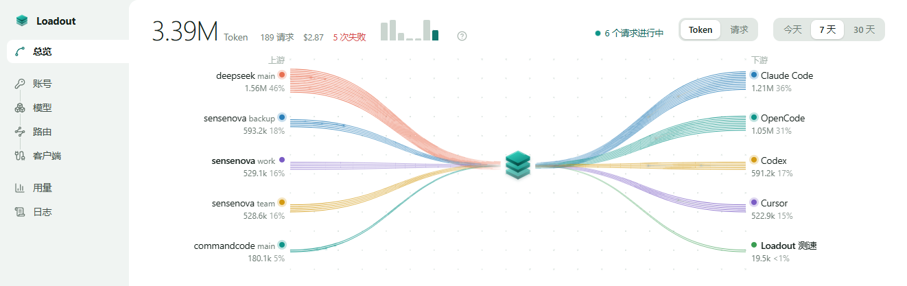
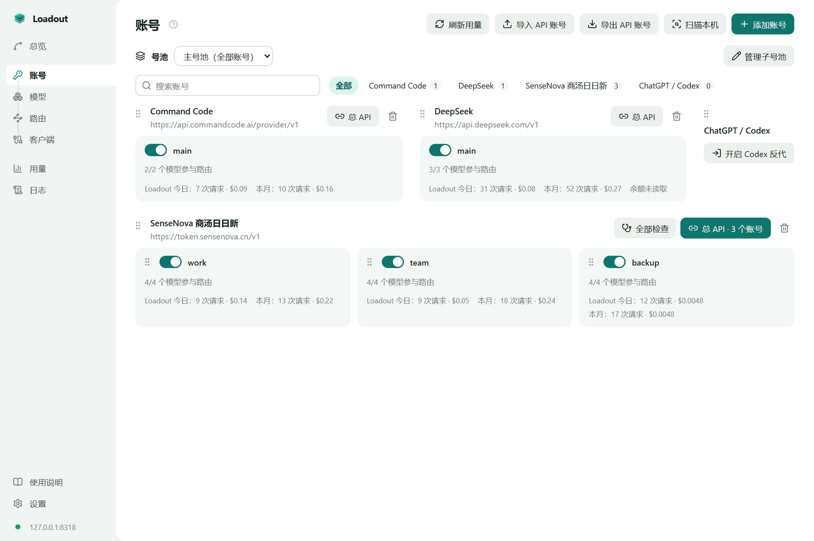
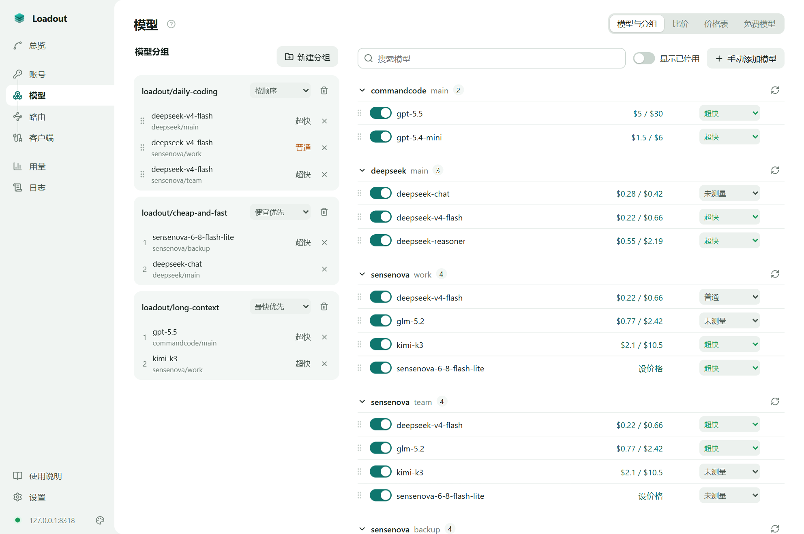
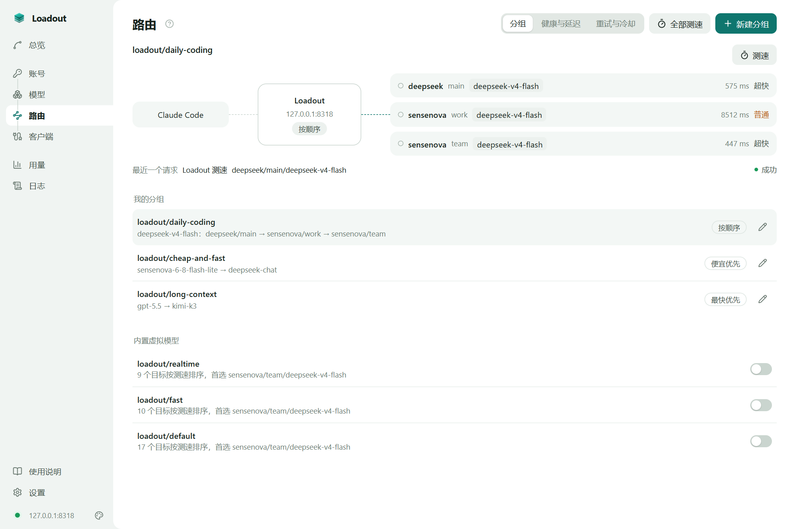
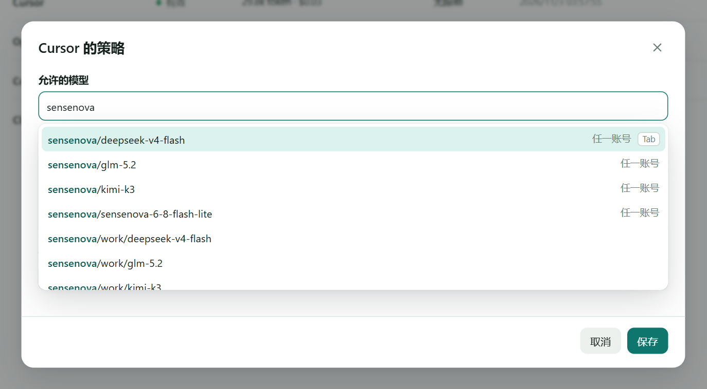
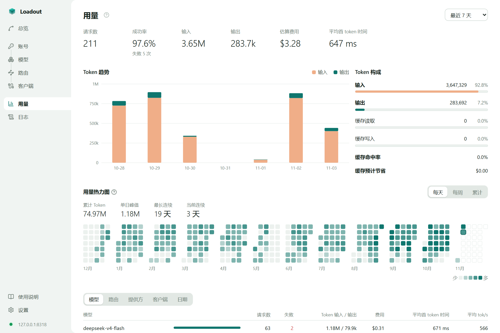
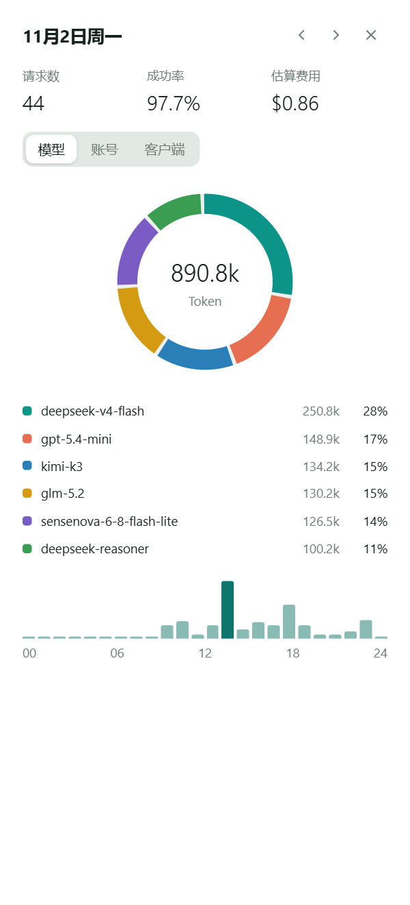
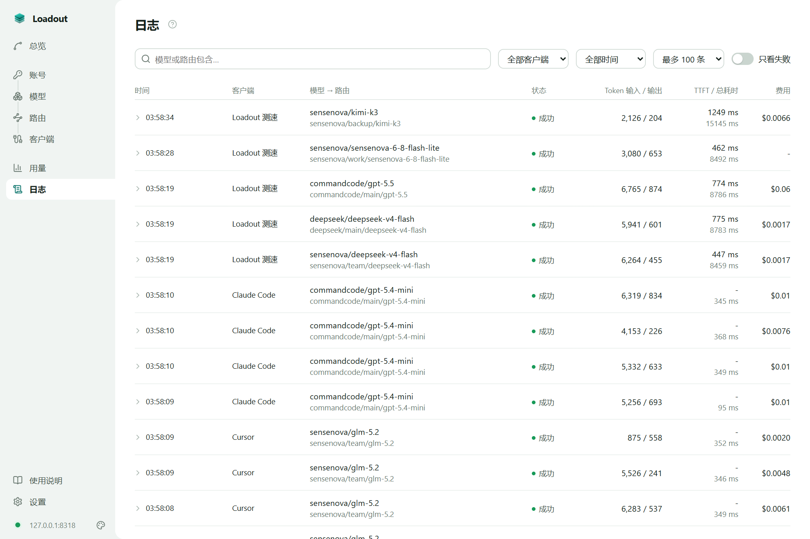
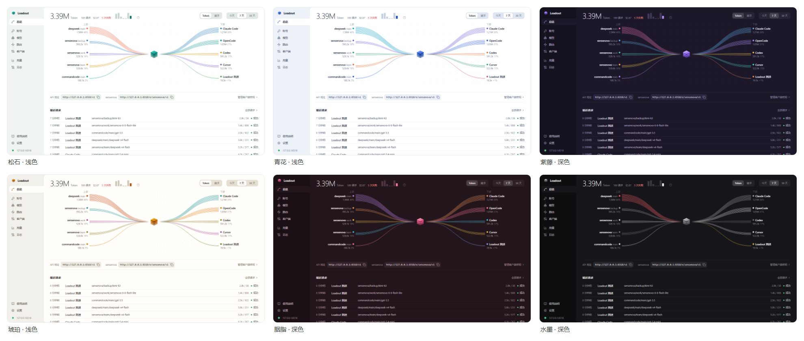

<div align="center">


# Loadout

**All your AI, one endpoint.**

你手上的 API 密钥、编码套餐和本地模型，汇成电脑上的一个地址。<br/>
所有软件都填它。账号出错自动换下一个，每个 token 往哪走都看得见。

[](https://github.com/SeaserL/Loadout/releases/latest)
[](#安装)
[](LICENSE)
[](backend/README.md)

[下载](https://github.com/SeaserL/Loadout/releases/latest) · [安装](#安装) · [从 0.4 升级](#和-04-的关系)

</div>



<sub>总览页。左边是上游账号，右边是使用它们的软件。线束的粗细是真实用量，光点是正在回复的请求，网关空闲时图是静止的。本页所有截图都用合成数据。</sub>

> **English:** Loadout is a Windows desktop app and local gateway. It pools your API keys, coding plans and local models behind one OpenAI- and Anthropic-compatible address on `127.0.0.1`, fails over between accounts, and shows every request flowing from upstream to the app that made it. Keys stay in Windows Credential Manager; request logs hold metadata only. The interface is available in Simplified Chinese and English; the built-in guide is in Chinese.

## 一个地址

```text
http://127.0.0.1:8318/v1
```

8318 被别的程序占用时，新安装会换一个端口并一直用它，总览页显示实际地址。OpenAI SDK 在后面接 `/chat/completions`，Anthropic SDK 接 `/v1/messages`，都能到达同一个网关。不用分两个地址，也不用管软件说的是哪种协议：Chat Completions、Responses、Messages 之间互相转换，流式和工具调用都支持。

每个软件用自己的客户端密钥，模型名用下面任何一种写法：

| 模型名 | 意思 |
|---|---|
| `loadout/分组名` | 你在模型页建的分组。账号挂了自动换下一个，日常用这个 |
| `服务商/模型` | 这家服务商的任一账号，按账号页的顺序选 |
| `服务商/账号/模型` | 优先用这个账号。它不可用时由同一模型的其他账号接手 |
| `loadout/default`、`fast`、`realtime` | 按测速结果自动排列候选，默认关闭。它们可能切换模型，要固定模型请用分组 |

## 一个请求经过的路

软件左侧的导航就是请求走的路：账号、模型、路由、客户端。按这个顺序设置一遍就能用，每页的 `?` 打开内置说明的对应章节。

### 账号



- 一家服务商可以放多个账号。拖动卡片调整顺序，这就是故障切换的顺序。
- 密钥存在 Windows 凭据管理器，数据库里只有引用。
- 卡片上有官方额度和余额（点了才读取），读不到的服务商显示 Loadout 自己记的请求数和估算费用。填上订阅价格和续费日，还能算出这个月用回了多少。
- **子号池**：把一部分账号存起来，切过去后所有路由只在这些账号里选，范围外的账号被点名也会被拒绝。
- **总 API**：给一家服务商单独一个地址 `/e/名称/v1`，客户端写裸模型名，请求只发给这家的账号。可以勾选每次请求换下一个账号，把额度摊开。
- **一键导出**：所有账号打包成一个加密的 `.loadout-keys` 文件，在另一台电脑上导入，缺的服务商和账号自动创建。
- **扫描本机**：找到已登录的 Codex、Claude Code 等工具并显示额度。这些登录默认只读，不转发请求。

### 模型



把右边的模型拖到左边的分组上，这个分组对客户端来说就是一个模型名。分组怎么选账号由你定：按顺序、最快优先、轮转、快重置优先、便宜优先、最少使用优先、随机。

同一页还有**比价**（同一个模型在不同账号上的价格，按你的输入、输出、缓存比例算出综合单价）、**价格表**和**免费模型目录**（哪家有什么免费额度，标出可能用提示词训练的那些）。费用都是估算，查不到价格时显示未知，不当作免费。

### 路由



选中一个分组，能看到它的候选账号：哪个在用，哪个在冷却，失败后轮到谁，最近一次请求走了哪条路。

失败时有三层保护：分组里的账号都在短暂冷却时先等一等；一个账号失败后休息一段时间，连续失败时间加倍；一家服务商连续报 5xx 时暂时熔断。网关不会自己定时探测上游，只有客户端请求和你的点击才会访问上游。

### 客户端



每个软件一把密钥，用量才分得开。策略里可以限定：

- **允许的模型**：输入时出现预测，按 Tab 或点击加入。不存在的名字存不进去。
- **账号**：这把密钥只用这些账号。
- **上限**：每天、每周、每月的费用，每分钟的请求数。到上限后这个客户端返回 429，其他客户端不受影响。

## 看得见发生了什么

### 总览

页面顶部的动图就是总览。所有动效都来自真实请求：

| 看到的 | 发生的事 |
|---|---|
| 一个灰点走向上游 | 请求刚发出去 |
| 线束流动，光点从左到右 | 上游正在回复，密度和流速跟着实际字节速度走，中间的图标随流量发亮 |
| 红点停在中间 | 这次上游失败，没有到达客户端 |

点一端聚焦这条流向，其他线变淡，数字换成这条流向的量。拖一端调整上下顺序。

### 用量

<table>
  <tr>
    <td width="74%"></td>
    <td width="26%"></td>
  </tr>
</table>

- 请求数、成功率、Token、费用和首字时间，按模型、路由、服务商、客户端、日期分组。
- **热力图**：最近一年，每天一格，每月一块，可以换成每周或累计。顶部是累计 Token、单日峰值和连续使用天数。
- **当日简报**：点任何一根柱子或一个方块，右侧滑出这一天的简报。环状图按模型、账号、客户端显示 Token 占比，下面是各小时的忙闲。开着时直接点别的日子，方向键切换前后一天。

日期按这台电脑的时区算。请求记录保留 400 天。

### 日志



只记录元数据：时间、客户端、模型、账号、状态、Token、耗时。提示词、回复和工具参数都不保存。点一行展开协议转换和切换记录。

## 外观



六套配色，各有浅色和深色，在设置页切换。页面切换、数字滚动和图表进场都有动效，**动画速率**可以在 0 到 2 倍之间调节，默认 1 倍，调到 0 就是关闭。

使用说明内置在软件里，不用翻网页。

## 服务商

| 类型 | 服务商 |
|---|---|
| 平台 API | DeepSeek、SenseNova 商汤日日新、Moonshot（Kimi API）、智谱 GLM、阿里云百炼、火山方舟、MiniMax、阶跃星辰、百度千帆、OpenAI、Google Gemini、xAI、Mistral、Groq、Cerebras |
| 中转和套餐 | OpenRouter、硅基流动、Command Code、OpenCode Go |
| 本机已登录 | WorkBuddy（复用桌面端的登录） |
| 逐账号开启 | ChatGPT / Codex 订阅（设备码登录，默认不参与路由） |
| 本地和自定义 | Ollama、LM Studio、任意 OpenAI 兼容地址 |

这些是内置的预设，底层路由和协议转换来自 OmniRoute。1.0 用真实请求验证过的是 WorkBuddy 和 DeepSeek，其他服务商只用模拟上游测试过。

> [!WARNING]
> WorkBuddy 连接和 Codex 订阅转发都不是官方 API，可能违反服务条款，账号有被限制的风险，由你自行决定是否使用。详见 [docs/providers](docs/providers/README.md)。

## 安全和隐私

- 网关只监听 `127.0.0.1`，检查 Host 和 Origin，`/v1` 的每个请求都要带客户端密钥。
- 打开软件不用输密码，但管理接口不是敞开的：桌面窗口通过私有管道拿到会话，这台电脑上的其他用户和网页进不来。
- 上游密钥只在 Windows 凭据管理器。客户端密钥只存哈希，只在创建时显示一次。
- 请求正文不落盘。
- 空闲时不连接任何上游。OmniRoute 自带的更新检查和公网 IP 查询被拦下了。打开免费目录同步后，它会访问目录服务，只传目录请求。
- 窗口打开时，最多每 6 小时查一次 GitHub 上有没有新版本，可以在设置页关掉。窗口关着时不查。

## 安装

1. 从 [Releases](https://github.com/SeaserL/Loadout/releases/latest) 下载 `Loadout-1.0.0-portable-windows-x64.zip`（约 380 MB），解压到一个路径不太深的文件夹，比如 `D:\Apps\Loadout`。
2. 双击里面的 `Loadout.exe`。

需要 Windows 10/11 x64 和 WebView2 Runtime（通常已预装）。这是绿色版，没有安装器和开机自启，运行时自带。数据放在程序文件夹旁边的 `loadout-fusion-isolated`，密钥在 Windows 凭据管理器。

关掉窗口后网关留在后台，软件照常能用；要完全退出，在托盘图标上右键选“退出并停止网关”。

### 更新

设置页可以检查、下载和安装新版本。下载和校验在后台进行，网关照常工作；点“安装并重启”时才换程序，进行中的请求会中断。新版本起不来时会自动恢复原来的版本。账号和数据不受影响。

换了底层 OmniRoute 版本的更新不能自动安装，软件会提示按 Release 说明手动升级。

### 从源码构建

需要：Git、Python 3、[Node.js 24.22.1](https://nodejs.org/dist/v24.22.1/)、Rust（版本由 `rust-toolchain.toml` 固定）、Visual Studio Build Tools（C++）、WebView2。

```powershell
git clone https://github.com/SeaserL/Loadout.git
cd Loadout
npm ci

# 还原后端：按固定版本克隆 OmniRoute，应用 backend/ 里的改动
python scripts\fusion\backend-source.py prepare
npm ci --ignore-scripts --prefix development\upstreams\omniroute\.claude\worktrees\loadout-phase11-v52
npm ci --prefix development\fusion\tools

# 构建并装配，最后一行输出包的位置
powershell -ExecutionPolicy Bypass -File scripts\fusion-release.ps1 -Action package -Node C:\path\to\node.exe
```

这套步骤还没有在一台干净的电脑上完整跑过。遇到问题请[开一个 issue](https://github.com/SeaserL/Loadout/issues)。发布和回归流程见[发布入口](docs/architecture/fusion-release-operations.md)。

## 和 0.4 的关系

1.0 是一次重做。网关运行时从自研的 Rust 换成了 [OmniRoute](https://github.com/cheaper-inference/OmniRoute)，保留 Loadout 的账号规则、分组、总 API、子号池和加密导出，界面全部重写。取舍见 [ADR-019](docs/adr/ADR-019-product-fusion-boundaries.md)。

| | 0.4 | 1.0 |
|---|---|---|
| 运行时 | Rust（`crates/`） | OmniRoute + `backend/` |
| 界面 | `apps/desktop` | `apps/fusion-console`、`apps/fusion-desktop` |
| 地址 | `127.0.0.1:8317` | `127.0.0.1:8318` |
| 管理方式 | 命名管道、`loadout` 命令行 | 桌面窗口 |

**0.4 不能覆盖更新到 1.0，要手动下载。** 0.4 的安装脚本只接受三个固定的程序文件，而 1.0 是另一套结构。两者可以同时运行，数据互不影响。要把账号带过来，在 0.4 里导出 `.loadout-keys`，在 1.0 里导入。

0.4 的“软件更新”页之后会提示找到了 v1.0.0 但没有可用的安装包（`Missing or duplicate Windows release asset`）。这是预期的，不影响网关。如果不想看到，在同一页关掉自动检查。

Rust 线的代码还在仓库里，版本号也同步到了 1.0.0，但不再是开发重点。

ChatGPT 网页会话转发、`loadout` 命令行和 `loadout setup` 只在 0.4 有。

## 致谢

| 项目 | 用在哪里 |
|---|---|
| [OmniRoute](https://github.com/cheaper-inference/OmniRoute)（MIT） | 网关运行时：路由、协议转换、SQLite、价格和免费目录。Loadout 在 v3.8.52 上打补丁 |
| [yetone/magpie](https://github.com/yetone/magpie)（MIT） | 界面和丝带流向图的设计参考。没有复制它的代码、Logo 或素材 |
| [AidenOrz/dsh-workbuddy-connect](https://github.com/AidenOrz/dsh-workbuddy-connect)（MIT） | WorkBuddy 连接器的部分模块，在 `fusion/vendor/` |

完整记录见 [THIRD_PARTY_NOTICES.md](THIRD_PARTY_NOTICES.md) 和[参考项目速查](docs/legal/reference-map.md)。

## 文档

- [后端：补丁和控制面](backend/README.md) · [发布入口](docs/architecture/fusion-release-operations.md) · [功能清单](docs/architecture/fusion-backend-status.md) · [产品重做记录](docs/research/2026-11-02-fusion-product-rebuild.md)
- [架构决策](docs/adr/README.md) · [执行计划](docs/exec-plans/completed) · [服务商说明](docs/providers/README.md) · [开发规范](docs/development-harness.md)

## 许可证

[Apache License 2.0](LICENSE)。贡献遵循 [DCO](https://developercertificate.org/)（`git commit -s`）。
