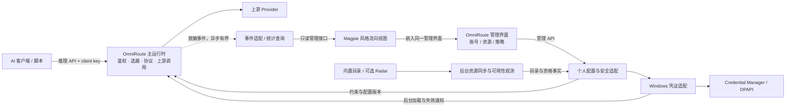
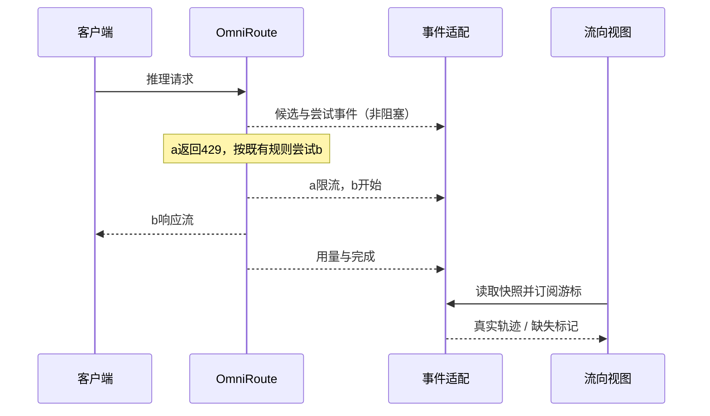

# Loadout 与 OmniRoute、Magpie 的融合架构草案

- 日期：2026-10-29
- 状态：**供审阅的设计草案，尚未实现或验证**
- 相关决策：[ADR-019 Proposed](../adr/ADR-019-product-fusion-boundaries.md)
- 输入：[可迁移需求包 R01–R16](../research/loadout-portable-requirements.md)
- 本地源码：[目录与锁定版本](../../development/README.md)

建议形成一个以 **OmniRoute 为主体的衍生产品**：沿用它的网关、Provider 接入、协议、管理界面和免费目录；保留 Loadout 的凭证保护、账号使用规则与验收经验；将 Magpie 的流向呈现适配为该产品中的视图。

三个项目承担不同责任。正常推理只经过一套网关，不依次穿过 Loadout、OmniRoute、Magpie。新代码应集中在凭证适配、个人策略配置、事件适配和可视化几处；这些边界能否保持足够小，是下一轮试点要验证的主要问题。

## 1. 总体连接



图中“个人配置与安全适配”“事件适配”等是逻辑模块，默认与 OmniRoute 后端同进程，不是额外微服务。管理 API 与推理 API 可由同一后台进程提供，但权限独立。浏览器或可选桌面壳退出，不终止后台网关。

## 2. 功能来自哪里

“沿用”指未来基于上游分支保留功能；“适配”指需要新接口/少量补丁；“行为迁移”指移植验收语义而非整段原代码。下表并不表示这些融合已完成。

| 功能块 | 主来源 | 复用方式 | 自有增量与边界 |
|---|---|---|---|
| HTTP 入口、Chat/Responses/Messages 协议 | OmniRoute | 沿用主链路 | 只补合同检查；不搬 Loadout protocol，不再叠 Magpie gateway |
| Provider 注册、模型目录、常规接入与认证流程 | OmniRoute | 沿用 | 首轮API key；订阅/网页按需单独开启，不能一并自动导入 |
| 多账号、冷却、failover、基础轮转 | OmniRoute | 原生配置优先 | Loadout 行为用独立用例约束；仅修原生缺口，不新写第二个调度器 |
| 子号池、总 API、点名账号与禁止换模型 | Loadout 规则 + OmniRoute 执行 | 行为迁移 | 个人配置编译为账号范围、映射、顺序；配置模块不发送推理请求 |
| Provider secret 与备份保护 | Loadout | 复用小型安全实现或算法/测试；新建 Node 绑定 | 不搬整个 Rust Core、Storage、IPC；所有写入必须经过统一边界 |
| Client key 鉴权 | OmniRoute 哈希鉴权 + Loadout 存储约束 | 适配 | 删除可还原原文和 reveal 依赖，只保留hash/prefix与首次展示 |
| 免费平台目录与 Radar | OmniRoute | 沿用目录客户端 | 新鲜度/本机观测/免费专用限制；不复制维护一份平台名单 |
| 账号、模型、用量管理页面 | OmniRoute | 沿用 | 仅添加必要策略项与未知/失效提示，不重建全套界面 |
| 实时请求流向、失败切换与细节交互 | Magpie | 设计借鉴，按文件挑选可移植算法/样式 | 在 React 中实现窄组件，消费新事件契约；不导入 Magpie 页面内核 |
| token/费用聚合流向 | OmniRoute 统计 + Magpie 展示思路 | 数据适配与视图 | 明确计量口径、失败尝试费用和未知值；不要求保存正文 |
| 实际路由事件与不阻塞统计 | Magpie trace 语义 + Loadout 有界遥测方式 | 事件模型借鉴 | OmniRoute 决策位置发事实事件；不以事后重算伪装执行记录 |
| Windows 后台生命周期 | OmniRoute headless 运行 + Loadout 生命周期约束 | 轻量启动适配 | GUI只连接既有后台；不保留全套旧daemon来管理新daemon |
| 配置/密钥迁移 | Loadout 备份需求 | 一次性迁移工具 | 版本化映射、加密文件、冲突预检；不长期双向同步两个数据库 |
| 原有端点/集成回归 | Loadout | 转为底座无关验收 | 保留假账号/真实故障复现规格，原Rust测试不能假称直接验证Node |

**Magpie 贡献在体验层和执行轨迹的表达，OmniRoute 贡献在产品主体，Loadout 贡献在个人行为与安全。** 不要求三方代码比例相等。

## 3. 必须看清的现有耦合

### OmniRoute

- `src/lib/db/providers.ts` 集中多种账号读写，调用 `encryption.ts`；还涉及 providerSpecificData、刷新与备份。凭证改造不能只改表单。
- `src/lib/db/apiKeys/secretAtRest.ts` 明确保留可还原 client key 供 reveal/export 使用，鉴权本身则使用 key_hash。改为hash-only时，应同时禁用查看原文与原文导出，旧客户端配置向导改为新建/轮换key。
- `src/sse/services/auth.ts` 有账号选择、affinity 与 quota preflight；部分路径会调用 `preflightQuota`。不能笼统宣布“上游已经满足Loadout热路径约束”。也不能为了去掉网络预检而打开会跳过全部额度政策的开关。
- `src/lib/usage/routeExplain.ts` 区分runtime与只读recompute；现有统计接口可复用，但重算结果不是原始候选顺序。
- `electron/main.js` 在自己持有 nextServer 时，于before-quit停止该服务器。不能直接把默认Electron退出行为当成ADR-002已满足。

### Magpie

`internal/gui/assets/plugins/routing/client.js` 是依赖 `magpie.plugin`、全局DOM工具、语言表和CSS变量的经典脚本，还含组编辑、历史请求、会话标题等功能。它读取 `/api/gateway/trace` 等接口，不是独立的React图表包。

因此先提炼“节点布局、连线/动画、失败路径、悬停明细”等可视表达；不连带移植组编辑器、整个plugin kernel、Go gateway、账号存储或request body查询。可单独提取的代码需逐文件保留MIT归属，不能整文件复制后通过大量全局兼容层维持运行。

### Loadout

`crates/secrets` 边界相对清晰；`crates/core/src/keys_export.rs` 依赖ControlPlane、Storage、Provider Registry等，不能直接塞进Node。建议复用凭证底层与加密封装/测试向量，迁移工具通过新适配器读取账号清单，而不是引入整个Core。

## 4. 数据所有权

| 数据 | 唯一权威写入者 | 其他模块如何访问 |
|---|---|---|
| Provider、connection、模型和基础设置 | OmniRoute管理后端 | 管理API/受控内部repository；界面不读SQLite |
| 个人Profile、子集、顺序、轮转与免费模式 | 个人策略模块 | 编译后的版本化约束；不直接修改上游健康状态 |
| Provider secret | Windows凭证适配 | 后台加载到运行时内存；数据库仅secret_ref |
| Client key | 鉴权管理模块 | hash/prefix持久化；原文只首次返回给创建者 |
| 冷却、在途、轮次、会话固定 | OmniRoute执行链 | 只读状态/事件；UI不得自己重算并覆盖 |
| 远端免费目录 | 上游内置目录 / Radar | 本机缓存与来源标记，用户覆盖单独保存 |
| 本账号可用性 | 本机观测模块 | 时间戳化metadata；不能回写为全平台有效结论 |
| 请求轨迹、用量聚合 | metadata事件存储 | 只读查询/订阅；视图无路由权限 |
| 图表布局、筛选、折叠 | UI | 普通偏好存储；不能改变账号访问范围 |

融合版有自己的数据目录。禁止直接打开现有Loadout生产SQLite让两个运行时共同写入。Profile引用稳定的connection ID，显示别名不是主键；导入时显式维护旧Account ID到新connection ID映射。

## 5. 连接契约

以下名称、接口与地址均为**拟议的融合接口**，不是声称上游已公开这些扩展点。先以少量静态集成接缝实现，不建设通用插件框架。

### 5.1 个人策略到网关

`RoutingPolicyV1` 至少包含：

```json
{
  "schemaVersion": 1,
  "revision": 7,
  "profileId": "personal",
  "allowedConnectionIds": ["a", "b", "c"],
  "modelRule": {
    "requested": "mock-model-v1",
    "upstream": "mock-model-v1",
    "allowModelChange": false
  },
  "strategy": "ordered",
  "preferredConnectionId": "a",
  "allowAccountFailover": true,
  "freeOnly": false
}
```

- 后台验证/编译后原子发布版本；一次请求绑定一个policy revision。动态撤销、禁用与健康状态仍在每次尝试前检查。
- 有效账号范围 = 全局子号池 ∩ client key授权 ∩ 入口账号范围 ∩ 模型资格 ∩ 当前可用性。空集拒绝，绝不解释成不限范围。
- 默认全局子号池语义必须明确承接；若改成“每个客户端各有Profile”，这是新交互，不能只改一个key就宣称所有客户端已经切池。
- OmniRoute仍负责最终选择和执行。适配层提供约束，不返回一套自己的fallback结果让上游再调度一次。
- UI的直接修改与上游原生API修改均经过同一校验边界；原生管理页面不能绕开全局范围或凭证边界。
- policy保存失败维持上一有效版本并返回错误；安全撤销失败应封锁受影响入口，不能继续使用撤销前的宽权限。

**语义勘误**：此前R02写成“点名账号不自动换号”过于绝对。ADR-003 §8与 `router/table.rs` 表明点名账号优先，但默认可同Provider同模型failover；禁用account failover才严格不换。ADR-015总API的点名账号也只决定首选、不参与轮转。Stateful Responses固定到目标则不得跨目标failover。

每请求轮转、顺序粘性、stateful固定必须是明确不同模式，不能让session affinity悄悄覆盖轮转；硬授权范围优先于任何模式。输出提交点采用现有严格契约：向客户端发出任何响应字节（含首个SSE事件）后不得重放到另一账号。

### 5.2 凭证适配

首选在OmniRoute后端内通过一个**Windows原生绑定**复用Loadout SecretStore能力。拟议Node接口为 `put/get/delete/exists`，只接受本产品命名空间的secret_ref；原生层串行访问Credential Manager。可从现有Rust crate构建薄Node-API绑定，但目前没有该绑定，也未证明其构建/分发成本。

- create/update：OS store成功写入新版本凭证后，事务提交secret_ref，再使旧缓存失效。DB失败则撤销新凭证；后台可回收无引用条目，不能误删旧有效凭证。
- 启动/更新：后台加载所需凭证并预备运行时内存对象。请求到达时缓存缺失应使账号不可选并触发后台恢复，不能每次请求启动helper或读取Windows凭据。
- delete/rotate：先撤销可选状态、通知缓存失效，再删除旧凭证；失败明确返回待清理状态。已发出的上游请求不能因本地撤销而被假称取消成功。
- refresh/import/backup/settings secret等同样经过边界。不能把嵌套providerSpecificData中的token留在数据库。
- 新API key进入管理后端后不回显；只有显式创建client key时首次展示。普通配置导出不含secret。
- Node执行器仍会在内存中接触密钥，这是发送上游请求所必需。JS字符串无法直接继承Rust清零保证；需要另行评审内存保留与日志边界，不能宣称与原Rust内存安全完全等价。
- 不因适配困难改用明文.env或可逆client key存储；数据库密文方案如另选，需另修ADR-004。

选择原生绑定是为了不增加第三个常驻管理进程。如果它造成过多构建或跨语言维护，可在独立验证后再比较受限长驻凭证helper；禁止顺势恢复完整Loadout Core作为另一套控制面。

### 5.3 真实事件到Magpie风格视图

`RoutingTraceEventV1`：

```json
{
  "schemaVersion": 1,
  "runtimeEpoch": "test-epoch",
  "seq": 42,
  "requestId": "test-request",
  "attemptId": "test-request:2",
  "kind": "attempt_finished",
  "policyRevision": 7,
  "clientId": "test-client",
  "connectionId": "b",
  "requestedModel": "mock-model-v1",
  "resolvedModel": "mock-model-v1",
  "outcome": "rate_limited",
  "retryAt": null,
  "inputTokens": null,
  "outputTokens": null,
  "source": "runtime"
}
```

事件类别建议：request_started、candidates_selected、attempt_started、first_output、attempt_finished、request_finished、request_cancelled、gap。只记录必要ID、枚举、计数与时间，禁止正文、认证头、工具参数、上游原始错误全文、邮件和本地路径。



- 不按每个token发UI事件；首个输出、阶段变化与节流后的计数即可。
- 有界队列满时不阻塞推理，记录丢失数量和gap；UI显示“轨迹不完整”，禁止编造缺失路径。
- `runtimeEpoch + seq` 作为顺序/去重标识；重连先取快照再按cursor续读。缓存过期或进程重启返回reset，不无限补发。
- 拟议 `GET /api/loadout/trace/snapshot` 与 `GET /api/loadout/trace/events` 使用管理会话鉴权；SSE的凭据不能放URL，校验Origin/Host。浏览器隐藏页面时停止动画或降低订阅频率。
- 管理权限默认看全局；若未来开放普通客户端自查，服务端按client身份过滤，不能靠前端隐藏账号。
- 历史聚合优先用OmniRoute现有统计；真实候选排序若缺记录就显示未知，不调用routeExplain重算来补“事实”。

视图分为实时轨迹和时间窗聚合。Sankey式丝带适用于后者；实时重试用轨迹线。Input/output/cache/reasoning计数口径需来自规范化usage，unknown不当0，失败尝试产生的费用单独计入，禁止重复加总共享额度或缓存token。

### 5.4 免费目录到可用池

`FreeResourceStatusV1` 分别记录：

| 字段组 | 含义 | 更新来源 |
|---|---|---|
| catalogVersion、generatedAt、fetchedAt | 目录版本、来源生成、本机取得时间 | OmniRoute内置目录/Radar |
| termsVerifiedAt、evidenceUrls、freeType、validUntil | 规则证据、周期/一次性/无量化上限、结束时间 | 可核验上游资料；未知保留null |
| lastSuccessAt、lastFailureAt、failureCategory、scope | 本账号/模型/访问环境的实际结果 | 被动metadata或显式启用的低频probe |
| quotaRemaining、resetAt、confidence | 本账号额度与可信度 | 官方用量/本机估算，标明来源 |
| effectiveEligibility、reason | 当前可否加入指定Profile | 本机策略和账号状态 |

目录条目不是Account，下载目录不会自动得到账号或额度。Radar是可选远端目录输入；本地源码包含客户端，不等于取得上游托管live服务或支持者权益。

远端同步故障保留最近可信缓存并显示stale；签名/格式不合法不替换缓存。每条规则的过期门槛按来源/有效期定义，不用一次新的fetchedAt刷新全部条目的核验时间。初始“免费专用”Profile只纳入能证明当前免费资格且不会静默扣费的已连接资源；unknown/过期需重新确认，不能退到付费。普通Profile仍可由用户明确允许付费。

同步/额度读取/probe在后台，时间间隔与额度预算可配置；默认以被动结果为主。本轮不注册任何持续监控任务、不请求免费推理端点。

### 5.5 管理面、生命周期与迁移

优先使用OmniRoute Web管理界面，未来桌面壳只连接独立用户级headless运行时。由当前Windows用户启动，不改为系统账户Service，不在每次请求启动CLI。首次拉起、重复启动、异常重启、退出UI、显式停止网关的状态分别定义；不要直接沿用Electron持有子服务器时的quit联动。

管理API必须独立鉴权，推理client key不能修改配置。采用Web管理意味着需要修订现行“只允许Named Pipe管理”的ADR-011；必须补Host/Origin、CSRF、会话与敏感操作校验，而非仅监听127.0.0.1。

后续迁移使用加密输入和版本化ID映射：预检Provider/模型/账号冲突 → 创建受保护凭证 → 提交配置 → 执行无真实调用的完整性检查 → 切换客户端。失败清理本次新建对象，不回写旧库。跨OS store与SQLite无法提供天然单事务，应有可恢复的导入阶段记录；记录只含引用，不含secret。

## 6. 拟议代码组织

以下路径是**未来融合分支中的布局**，本轮只建立development下参考源码，没有创建这些实现：

```text
OmniRoute-derived repository
├─ src/                         上游主体，保持原目录
│  └─ loadout/
│     ├─ policy/                配置验证、约束编译，不执行推理
│     ├─ credentials/           OS store与上游读写适配
│     ├─ telemetry/             规范化事件、快照、脱敏
│     └─ resources/             免费条目新鲜度、本机观测
├─ src/app/.../flow/            Magpie风格React视图，纯显示
├─ native/windows-credentials/  薄绑定，复用必要Loadout安全代码
├─ tools/migrate-loadout/       单次迁移/导出适配
└─ tests/loadout-contracts/     底座无关行为与隔离验收
```

选择上游派生分支作为主体，而不是把它散拆后塞进当前Rust workspace。开发参考checkout始终干净；真正融合代码必须进入有版本管理的工作区/分支，不能写在被ignore的参考目录里后再忘记提交。本轮不创建远端fork或推送。

改动维护清单分四类：原生配置、独立增量、上游可接受的小修复、暂需私有补丁。每个补丁记录入口文件、理由、上游SHA、对应回归，升级时只审查这些接缝。若出现私有协议转换器、第二个账号调度器或需要移植Magpie整个后端，视为偏离设计，重新选边界。

## 7. 许可证与文件来源

本地版本：OmniRoute v3.8.52 / ad6f33f66；Magpie v0.1.2026 / fd80ed99；Loadout Apache-2.0。上游均保留根LICENSE及第三方notices。锁定版本和LICENSE SHA256见 [来源清单](../../development/upstreams.lock.json)。

选读路径的祖先目录未发现覆盖根MIT的嵌套许可证；该检查只覆盖下列代码，不代表所有依赖/图片/品牌素材都可按根MIT移植。Magpie另有 `internal/qoder/LICENSE`，OmniRoute有插件子树许可证与原生transport notices。融合时必须按实际新增文件和依赖继续核查。

| 来源 | 本地可打开的依据 | 拟复用边界 |
|---|---|---|
| OmniRoute账号 | providers.ts、encryption.ts | 凭证接缝，不直接接受明文回退 |
| OmniRoute入口key | secretAtRest.ts | 保留hash鉴权，移除可逆保存/reveal依赖 |
| OmniRoute选路 | keyConnectionScope.ts、auth.ts | 账号范围、顺序与轮转、preflight边界 |
| OmniRoute执行 | chat.ts、chatCore.ts | 使用上游执行链，加入少量事实事件 |
| OmniRoute目录 | radar/index.ts | 缓存/来源/覆盖机制 |
| OmniRoute统计 | routeExplain.ts、usageHistory.ts | 区分执行记录与recompute，剔除正文依赖 |
| OmniRoute生命周期 | electron/main.js | 不采用随GUI退出停止自有server的形态 |
| Magpie流向 | client.js、routing.css | 布局/动画/交互思路，按组件选择性移植 |
| Magpie轨迹 | trace.go | 真实决策记录语义，不复制整个Route结构和后台 |
| Loadout凭证 | [store.rs](../../crates/secrets/src/store.rs)、[windows.rs](../../crates/secrets/src/windows.rs) | SecretStore及Windows实现的必要子集 |
| Loadout备份 | [keys_export.rs](../../crates/core/src/keys_export.rs) | 加密封装/测试向量，拆除Core耦合 |
| Loadout账号 | [table.rs](../../crates/router/src/table.rs)、[select.rs](../../crates/router/src/select.rs)、[subpool.rs](../../crates/core/src/subpool.rs) | 行为规则与测试，不维护第二套路由 |
| Loadout遥测 | [sinks.rs](../../crates/core/src/sinks.rs)、[telemetry.rs](../../crates/storage/src/telemetry.rs) | 脱敏与有界非阻塞语义 |

本轮只是完整源码checkout与原创设计，没有把上游实现复制进产品模块。后续移植必须保留原版权/许可证并记入THIRD_PARTY_NOTICES；不能将MIT来源文件一律改成“原创Apache”头。新写的原创适配按本仓库Apache-2.0约定。Magpie品牌图标不是实现该交互的必要条件，默认使用融合产品自己的标识。

## 8. 当前 ADR 如何处理

[ADR-019](../adr/ADR-019-product-fusion-boundaries.md) 当前为Proposed，**不使现行生产规则失效**。

| 现行规则 | 融合方案处理 |
|---|---|
| ADR-001 Rust/Tauri主体 | 拟改为OmniRoute主体与窄Windows绑定，需接受新ADR后才改实现 |
| ADR-002 独立后台 | 保留行为，替换进程/通信实现 |
| ADR-003 RouteSnapshot热路径 | 不自动宣称等价；须逐路径验证缓存/DB/preflight，禁止远程分类/额度查询进入选路 |
| ADR-004 OS store/DB引用/client hash | 保留持久化底线；Node内存清零差异待审查 |
| ADR-005 capability-first | 自有扩展保持能力接口；上游内部已有Provider分支，必须明确上游与自有代码边界 |
| ADR-006 canonical与stateful | 保留协议行为契约，内部canonical实现交上游；stateful原生固定或拒绝 |
| ADR-007 无动态插件 | 自有适配为静态构建；不因此启用任意远端插件 |
| ADR-008 metadata隐私 | 保留，拒绝为了图表启用正文日志 |
| ADR-010/015 寻址与总API | 行为保留；URL/别名可迁移；默认模型fallback须显式区分于exact请求 |
| ADR-011 Named Pipe管理 | 拟允许受保护的本地Web管理面，必须完整替代浏览器攻击防护 |
| ADR-018 更新 | 将来跟随经验证的上游基准与本地补丁版本，不直接自动覆盖融合安装 |

热路径是重大潜在冲突：上游现有cached settings、数据库读取与quota preflight不等于当前RouteSnapshot。先验证能否在一个有限接缝内实现所需隔离；如果必须重写其大部分调度器，就不满足少维护目标，不能用一句“沿用上游”掩盖。

## 9. 运行与失败隔离

| 故障 | 期望表现 |
|---|---|
| UI关闭、SSE断开或图表异常 | 网关继续服务；重连恢复快照，不重放推理 |
| Radar不可达/旧目录 | 用最近可信资料并标stale；不冒充刚核验，不突破freeOnly |
| OS store/绑定加载失败 | 受影响账号不可选；没有明文回退；健康页明确原因 |
| Profile编译失败 | 返回校验错误；保留上一有效配置，撤销类操作失败则封锁受影响入口 |
| 事件队列满 | 请求继续；记录gap/drop，不伪造完整图表 |
| 全部账号冷却 | 在显式有界等待内按规则恢复或返回错误；可取消；不暗中换模型 |
| 流输出后上游中断 | 同一响应明确结束/报错，不尝试另一个账号重放 |
| 上游升级与补丁冲突 | 不覆盖现有运行版本；在隔离目录修复和验收后再切换 |

## 10. 开发顺序与验收

| 阶段 | 交付 | 通过条件 |
|---|---|---|
| A 当前文档阶段 | 本地源码、来源清单、解耦文档、Proposed ADR | 可复现来源，无生产变更 |
| B 安全与后台原型 | 假账号OS store、hash-only client key、独立headless启动 | 无明文落盘、管理权限正确、UI退出不停止服务；预检不阻塞热路径 |
| C 账号行为迁移 | Profile约束、子池/总API/顺序与轮转 | 3账号429复现、空集拒绝、点名账号/禁用failover/stateful分别正确 |
| D 只读可视化 | 真实事件适配与Magpie风格组件 | 重试轨迹真实；gap、重连、unknown、费用口径正确；关闭视图不影响TTFT |
| E 免费资源状态 | 上游目录 + 本机观测 + 四类时间 | 同步日期不冒充核验；过期/额度耗尽不会静默扣费 |
| F 升级与迁移 | 两版本补丁升级、加密迁移/回滚包 | 改动仍集中，版本和数据可回滚，再安排授权的实际流量验证 |

B/C失败时暂停扩大融合，不先投入整套漂亮界面。D不要求先移植Magpie全UI。所有测试按Loadout隔离约定使用临时目录、端口、凭证前缀；默认无真实Provider调用。性能门槛沿用当前Harness，任何放宽都需明确决策。

## 11. 本地脚手架与最终清理

现在存在：

```text
D:\Loadout\
├─ development\
│  ├─ README.md
│  ├─ upstreams.lock.json
│  └─ upstreams\                  被父仓库忽略
│     ├─ omniroute\.git + source
│     └─ magpie\.git + source
└─ docs\architecture\loadout-fusion-design.md
```

两份checkout不加入当前构建，也不作为最终产品的嵌套依赖。未来产品应拥有一套正式源码与锁定依赖。融合版本完成后，确认所有必要移植、许可证和回滚材料已保存，构建不再引用参考目录，再按 [清理条件](../../development/README.md) 删除临时checkout。

源码拼接的完成标准是**上游主体持续可升级，自有增量可定位，行为契约可验收**，而不是三个项目的所有功能都出现在一个菜单里。

## 039 实验反馈（2026-10-30）

[第一阶段隔离验证](../research/2026-10-30-omniroute-phase1-validation.md)已完成：原生独立后台、主要账号行为与OS凭证持久化分别获得运行证据。keytar可复用，暂不需要新增Rust/Node绑定；小补丁不等于完整融合包。相邻标签静态试套有4个文件接缝变化，热请求发送前仍有普通SQL依赖，Node清零与完整安全写入路径仍待验证。因此保留正式Loadout，ADR-019继续Proposed，在发布包和前向升级门槛前不做UI融合。

